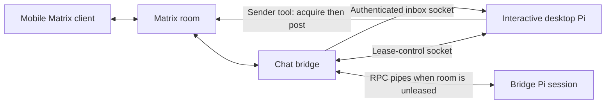

# Pi chat bridge

Chat with a Pi coding agent from your desktop or phone through Matrix and Discord. Keep a task list, choose a conversation model, run background work, and save a readable copy when you are done.

The optional desktop extension lets your open Pi session take attention for a Matrix room.

While that lease is active, messages from your phone enter the **same desktop Pi session**, with its current working context. When desktop attention ends, the bridge handles subsequent messages using its own saved context and the room's recent history.


Read [attention, awareness, and continuity](docs/attention.md) for the mechanism, sequence diagrams, protocol, and delivery limits. See [source provenance](docs/sources.md), [installation](docs/installation.md), [tools and extensions](docs/components.md), [reviews](docs/reviews.md), and [the ledger](docs/ledger.md), [task ledger](docs/tasks.md), [session export](docs/session-export.md), and [conversation modes](docs/modes.md).

## Contents

| Directory | Purpose |
| --- | --- |
| `bridge/` | Matrix/Discord adapters, Pi RPC lifecycle, room leases, socket services, review queue |
| [`extensions/`](extensions/README.md) | Extension inventory and interactive/headless context guide: inbox, labels, shell suggestions, questions, web tools, clock, background jobs, capture and model aliases |
| `tools/` | Canonical Matrix operations, messaging, history, reactions, activity/session clients, ledger and fix tooling |
| [`skills/`](skills/README.md) | Agent-facing messaging, reviews and ledger guidance, plus portable environment diagnostics and tmux pane control |
| [`runtime/`](runtime/README.md) | Public non-root Pi/bridge container, Supervisor, Python Playwright client and Compose setup |
| `tests/` | Synthetic fixtures and offline behavior tests |
| `examples/` | Placeholder configuration only |

The bridge runs on Linux with Python 3.11+ and a compatible Pi executable. Extension tests use Node 24 and Bun. Pi must expose the extension hooks and RPC events described in the installation guide. No model, provider endpoint, contact, deployment, or credentials are configured for you.

## Latest features

- Optional [session model approval and next-prompt drafting](docs/session-assistants.md), with explicit approval/provider boundaries.
- Native Pi SelectList navigation (including wrapping) inside bounded menus.
- Matrix attention delivery preserves authored quotes while stripping recognized reply fallbacks.
- Bounded, themed extension menus with consistent keyboard help, restored status colors and mouse/encoded-key support.
- Task-scoped actions and honest request-stop markers; stable HUD widgets without refresh reordering.
- Colored background-job states and human-readable CPU-time/memory displays.

- Optional [Pi/bridge runtime container](runtime/README.md), managed by Supervisor, with the Python Playwright client but no browser or database services.

- Optional [environment-doctor and tmux skills](skills/README.md) for local diagnostics and controlled pane interaction.
- Task file/URL evidence and opt-in recent-context judging, linked questions/reviews, optional subagent/job tracking, editing and confirmed pruning.
- TUI attention bells with a [minimal tmux snippet](docs/attention-bells.md).
- Counts-only bridge [task/subagent workload metrics](docs/workload-metrics.md), with explicit coverage and freshness.
- Peer/native slash-text controls, safer mode recovery, quoted-reply context and room-bucketed indicators.
- Reload supported profile settings without restarting the bridge.
- Configurable conversation model modes, with explicit switching on Matrix and Discord.
- Bounded Discord reconnect recovery with per-scope holds and retries.
- Branch-persistent session task ledger with evidence judging, user overrides, agent unblocking, colored progress with a one-task progress limit, list sharing, and advisory summary steering.
- Standalone, private HTML session export with optional cached AI chapters.
- Configurable active background-job limits and completed-history pruning; artifacts are preserved.

All inference features require existing provider and spending authorization. Components are opt-in.

## Checks

```sh
python -m pip install -r requirements.txt -r requirements-dev.txt -r requirements-ledger.txt -r requirements-web.txt
npm ci --prefix extensions --ignore-scripts
python -m unittest discover -s tests/bridge -q
python -m unittest discover -s tests -p 'test_*.py' -q
python -m unittest discover -s skills/environment-doctor/tests -q
python -m unittest discover -s skills/tmux/tests -q
python -m unittest discover -s extensions/web-search -p 'test_*.py' -q
node --test tests/*.test.cjs extensions/web-search/*.test.mjs extensions/observability/pi-capture/test/*.test.mjs extensions/observability/pi-topic/test/*.test.mjs
bun test tests/room-lease.test.ts
python -m ruff check --select E4,E7,E9,F bridge tools tests skills
python -m mypy --follow-imports=silent --ignore-missing-imports bridge
node extensions/observability/pi-topic/test/extension-smoke.mjs
python tools/audit_export.py
```

Skill tests use Python's standard library. Install tmux to exercise the isolated-server
pane tests; without it those live cases skip. The existing top-level unittest
discovery also runs both bundled skill suites; CI uses its runner's tmux package.

Runtime image build/lifecycle tests require Linux Docker; they run through top-level
unittest discovery when Docker is available, and are required on CI. They use a
synthetic transport and offline Pi providers, never a real model/account.

Background-job tests additionally require a systemd user manager and skip without one; see the [stable backend prerequisites and limits](docs/background-jobs.md).

Tests use fake transports/models and temporary files; some bind local TCP or Unix sockets. A full run needs those local operations permitted. Database migrations target a separately configured PostgreSQL service. No test requires production accounts or paid inference.

Source is MIT licensed; retained third-party notices are in [LICENSE](LICENSE) and the Unicode data file. Operational profiles, logs, transcripts, database contents, and credentials belong outside this repository.

## How messages travel (technical reference)



The bridge owns transport connections and credentials. The desktop inbox and attention controls use local Unix sockets; the bridge handles unleased conversations through Pi RPC. See [attention and continuity](docs/attention.md) for protocol details and limits.
