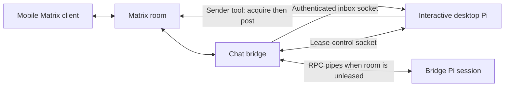

# Pi chat bridge

Keep a Pi coding session in conversation across a desktop terminal and mobile chat. A Python bridge listens to Matrix and Discord; a TypeScript extension lets an interactive desktop Pi session temporarily take attention for a Matrix room over local Unix sockets.

While that lease is active, messages from your phone enter the **same desktop Pi session**, with its current working context. When the lease ends, the bridge handles subsequent messages using its own saved context and the room's recent history.



Read [attention, awareness, and continuity](docs/attention.md) for the mechanism, sequence diagrams, protocol, and delivery limits. See [installation](docs/installation.md), [tools and extensions](docs/components.md), [reviews](docs/reviews.md), and [the ledger](docs/ledger.md).

## Contents

| Directory | Purpose |
| --- | --- |
| `bridge/` | Matrix/Discord adapters, Pi RPC lifecycle, room leases, socket services, review queue |
| `extensions/` | Interactive inbox, room labels, shell suggestions, questions, web tools, capture, topic labels |
| `tools/` | Messaging, history, reactions, activity/session clients, ledger and fix tooling |
| `skills/` | Agent-facing guidance for messaging, reading, awareness, reviews, and ledger use |
| `tests/` | Synthetic fixtures and offline behavior tests |
| `examples/` | Placeholder configuration only |

The bridge runs on Linux with Python 3.11+ and a compatible Pi executable. Extension tests use Node 24 and Bun. Pi must expose the extension hooks and RPC events described in the installation guide. No model, provider endpoint, contact, deployment, or credentials are configured for you.

## Checks

```sh
python -m pip install -r requirements.txt -r requirements-dev.txt -r requirements-ledger.txt -r requirements-web.txt
npm ci --prefix extensions --ignore-scripts
python -m unittest discover -s tests/bridge -q
python -m unittest discover -s tests -p 'test_*.py' -q
python -m unittest discover -s extensions/web-search -p 'test_*.py' -q
node --test tests/*.test.cjs extensions/web-search/*.test.mjs extensions/observability/pi-capture/test/*.test.mjs extensions/observability/pi-topic/test/*.test.mjs
bun test tests/room-lease.test.ts
python -m ruff check --select E4,E7,E9,F bridge tools tests
```

Tests use fake transports/models and temporary files; some bind local TCP or Unix sockets. A full run needs those local operations permitted. Database migrations target a separately configured PostgreSQL service. No test requires production accounts or paid inference.

Source is MIT licensed; retained third-party notices are in [LICENSE](LICENSE) and the Unicode data file. Operational profiles, logs, transcripts, database contents, and credentials belong outside this repository.
