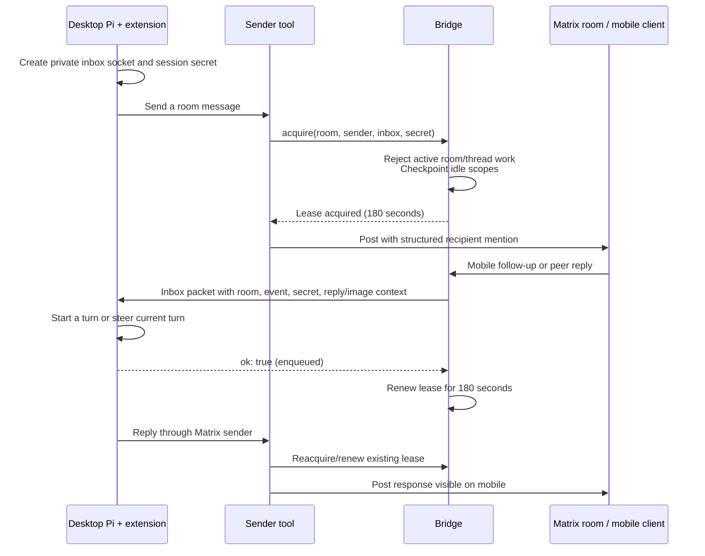
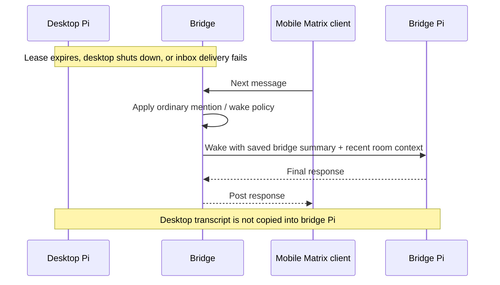

# Attention, awareness, and continuity

**Awareness** is the bridge's ability to receive chat traffic, decide whether a conversation should wake, and provide relevant context. **Attention** is temporary routing ownership: an interactive Pi session can claim a Matrix room so incoming messages reach that session instead of starting another bridge Pi session.

The bridge keeps listening while attention belongs to the desktop. Matrix credentials remain with the transport processes; forwarded inbox packets carry attributed messages, not access tokens. The interactive sender is separately authenticated for outbound messages.

## From desktop to mobile and back

Start work in interactive Pi, load `room-lease.ts`, and send into an enabled Matrix room with `message-agent`. The sender acquires attention **before** posting, closing the race in which a fast reply could wake a second Pi process.

Now leave the terminal and open that room on a phone using a separate human Matrix account. A message such as “Use the smaller version, and show me the result” is forwarded to the already-running desktop session. If Pi is idle it starts a turn; if Pi is busy it receives steering. Its current working context stays with it. Have Pi send its response through the Matrix sender to make the result visible on the phone. Return to the desktop and continue in that same session.

This is continuity of a **live session**, not transcript migration. The desktop Pi process, bridge, and network must remain available. Terminal replies are not automatically mirrored to Matrix. Posts from the bridge's own Matrix account are filtered to avoid loops, so mobile participation should use a distinct human account. Interactive attention is implemented for Matrix; Discord remains on the bridge runtime.

A lease expires after 180 seconds without an acquisition or acknowledged delivery. Periodic status checks show remaining time but do not extend it. A quiet desktop task can therefore outlast its lease.

The room provides a shared conversation surface during fallback, but facts that existed only in the terminal are not guaranteed to be available to bridge Pi. Preserve relevant decisions in the room when cross-device continuity matters. Bridge restart also discards leases; send again from interactive Pi to reacquire.

## Bridge awareness

Each agent/transport/conversation scope has its own session. An explicit mention can wake a sleeping scope; configured wake-on-any rooms/channels also admit ordinary messages. While awake, unaddressed messages can enter as optional context. They may steer an active turn or start another turn in the resident session. The model may respond, react, or return exactly `[[bridge:pass]]` when no text reply is useful.

On wake, adapters retrieve bounded recent history. The runtime checkpoints idle scopes after its three-minute inactivity window, preserving a summary for the next wake. Inbound/outbound activity and active work affect lifecycle timing; “awake” does not necessarily mean a turn is executing. Failed checkpoint state blocks an unsafe handoff and has an explicit recovery path.

Bridge-generated acknowledgements and progress updates do not start conversations. Terminal peer replies and intentional invitations have separate routing rules, including a three-hop invitation limit. Review requests from a configured webhook identity use their durable queue rather than ordinary chat turns.

## Two Unix sockets

The bridge owns `bridge-room-lease.sock` in its configured state directory. Interactive Pi creates a temporary directory containing `inbox.sock`. Directories are mode `0700`; sockets are mode `0600`. The bridge checks Linux `SO_PEERCRED` to require its OS user. Inbox packets must contain the extension's random per-session secret. This is a local same-user trust boundary, not isolation against other software running as that user.

Each connection carries one newline-terminated JSON request and response. The control socket accepts at most 16 KiB per request. The inbox bounds packets to 30 MB for image attachments.

| Control operation | Request fields | Result |
| --- | --- | --- |
| `acquire` | `room`, `sender`, `inbox`, `secret` | `ok`, `created`; renews if already owned by that inbox/secret |
| `release` | `room`, `sender`, `secret` | `ok`; releases matching ownership |
| `status` | `secret` | `ok`, `leases: [{room, seconds}]`; no renewal |
| `release_all` | `secret` | `ok`, `released` count |

Acquisition is restricted to configured rooms and the bridge account. A different interactive session cannot take a current lease. The bridge checks both the room and its thread scopes for active work, checkpoints idle scopes, and serializes acquisition with final event admission.

Inbox packets contain `secret`, `room`, `event`, optional `image` and `reply`, plus `ping` and `recipient` attribution. The extension enqueues using `sendUserMessage`, with `deliverAs: "steer"` when busy. It runs only in TUI mode and refuses activation in bridge RPC sessions.

## Delivery and failure semantics

- An acknowledgement means Pi enqueued the message, not that a model completed a response. Missing model/auth configuration rejects ordinary delivery. A subsequent provider failure can still leave an accepted message unanswered.
- Missing/negative acknowledgement removes the lease and falls back to ordinary bridge routing. A lost acknowledgement after enqueue can cause duplicate processing; this is not exactly-once delivery.
- Event IDs suppress duplicate inbox deliveries. Seen original-message IDs can be reconstructed from the current session branch. Leases and pending deliveries are not durable queues for a later session.
- Text includes room, sender, event and thread attribution. Reply context quotes one parent fetched from that room; unavailable originals are marked explicitly.
- Images use bounded attachments (up to 20 MB source media). Missing media is announced rather than invented.
- Original messages arrive immediately. Edits are coalesced until 60 seconds after the last edit, then delivered with original/latest event IDs. Deferred edits check that attention and model access still exist before delivery; they are discarded when attention ends.
- Session shutdown releases all rooms and clears pending edits. A definite send rejection releases a newly created lease; ambiguous network failure leaves it to expire because the Matrix PUT may already have succeeded.
