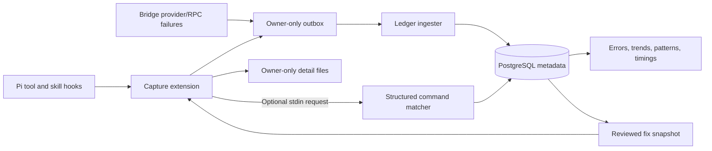

# Capture, error ledger, and reviewed fixes

The capture extension and ledger form one optional observability pipeline. Local evidence stays with its owner; shared database records contain bounded redacted metadata. Redaction is best effort, not a claim that arbitrary prose is safe to publish.



## Local capture

Load `extensions/observability/pi-capture/index.ts`, keeping its sibling modules and `../common/redact.mjs` together. Set `PI_CAPTURE_AGENT` to a generic installation-selected identifier, `PI_CAPTURE_ORIGIN` to a process origin such as `interactive` or `bridge_matrix`, and `PI_CAPTURE_ROOT` to a private durable directory. Bridge sessions set these from their profile and transport.

Capture records tool outcomes, timing, bounded redacted shell commands, error signatures, fix IDs, and skill load/invocation metadata. Success records omit tool output and preceding conversation. Error details can contain redacted arguments, output, and a bounded preceding-message window; files remain local at mode `0600` under mode-`0700` directories. Outbox records reference details by path/hash. Do not commit either directory.

`PI_CAPTURE_REDACTION_FILE` optionally names a private JSON file with a `secrets` string array. Sensitive environment values and common credential formats are also masked. An unreadable or invalid configured redaction file disables capture/excerpt output. Recording failures do not change tool execution.

## Database and operations

Install `requirements-ledger.txt`. Use a fresh PostgreSQL database and a migration-capable writer identity to run the six bundled migrations:

```sh
python -m tools.ledger.error_cli migrate
python -m tools.ledger.error_cli ingest --outbox "$OUTBOX" --processed "$PROCESSED"
python -m tools.ledger.error_cli errors --unresolved-only
python -m tools.ledger.error_cli trends
python -m tools.ledger.error_cli patterns
python -m tools.ledger.error_cli duration-stats
python -m tools.ledger.error_cli daily
```

Read-only commands use `PI_LEDGER_DSN`; mutation commands use `PI_LEDGER_WRITER_DSN`, with no reader-to-writer fallback. Configure database grants according to each role's operations. Fix publication should use a separately provisioned publisher credential in the writer variable, not the ingestion identity. `daily` prints a bounded summary; it does not contact chat or start a meeting.

Migrations use an advisory lock, version history, and checksums. This export has generalized identity constraints, so use a fresh database; do not point it at a differently checksummed private schema. Ingestion validates payloads and acknowledges outbox files only after database commit. Malformed payloads are quarantined while database/permission failures preserve retryable input.

## Fix proposals and lookup

`fixes` lists the catalog. An `err-...` reference resolves an occurrence and returns applicable, approved, digest-verified fixes. `draft-fix`, `check-fix`, `fix-evidence`, and `corroborate-fix` preserve cited evidence and owner review. `publish-fix --file "$PROPOSAL"` reads a bounded owner-private JSON document. It is an explicit publishing operation, not automatic repair.

Export reviewed fixes for a configured agent and enabled skills:

```sh
python -m tools.ledger.error_cli export-fixes --agent example_agent \
  --enabled-skill systematic-debugging --output "$FIX_SNAPSHOT"
```

Set `PI_CAPTURE_FIXES` and `PI_CAPTURE_ENABLED_SKILLS` accordingly. The extension verifies the snapshot's canonical content digest, matches agent/skill scope and regex, and applies notification cooldowns. A changed fix needs fresh review/export. A digest detects content drift; it is not a cryptographic signature proving who approved the fix. Protect writer credentials and snapshots accordingly.

## Structured matching

The included tree-sitter Bash matcher extracts normalized command forms, parses error classes, and ranks reviewed examples stored in PostgreSQL. Set `PI_CAPTURE_MATCH_REPO` to this repository, `PI_CAPTURE_MATCH_PYTHON` to its Python interpreter, and a scoped `PI_LEDGER_DSN` to enable the extension's optional lookup. In `PI_CAPTURE_NUDGE_MODE=dry-run`, redacted bounded command/error input goes over stdin to `python -m tools.ledger.error_cli match --stdin`; no command text enters process arguments. The child does not receive the writer DSN.

Candidate scores express ranking, not calibrated confidence or permission to apply a fix. Intentional failure probes are excluded. Parse ambiguity can cause abstention; missing configuration or a timed-out lookup does not block tool execution. `forms`, `trials`, `backfill-parses`, and `publish-example` support inspection and maintenance; consult `--help` for exact arguments and use the corresponding database role.
